# Codyssey 개발 워크스테이션 구축

## 1. 프로젝트 개요
Linux CLI, Docker, Git/GitHub를 활용하여 재현 가능한 개발 환경을 구축하고 검증하는 프로젝트입니다.

## 2. 개발 환경
- OS: Windows + WSL2 Ubuntu 26.04.1 LTS
- Shell: Bash
- Terminal: Windows Terminal
- Container Engine: Docker Desktop (Docker 29.9.2)
- Git: GitHub 원격 저장소 연결(Git 2.53.0)
- Git Branch: main

## 3. 수행 체크리스트
- [x] Linux 터미널 기본 명령어 실습
- [x] 파일 및 디렉토리 권한 변경
- [x] Docker 설치 및 실행 확인
- [x] hello-world 컨테이너 실행
- [x] Ubuntu 컨테이너 실행 및 재접속
- [x] Dockerfile 기반 Nginx 이미지 빌드
- [x] 포트 8080 웹 서버 접속 성공
- [x] 바인드 마운트 변경 반영 검증
- [x] Docker 볼륨 데이터 영속성 검증
- [x] Docker 이미지, 로그, 리소스 확인
- [x] Git 사용자 정보 및 기본 브랜치 설정
- [x] GitHub 원격 저장소 연결 확인
- [ ] VSCode GitHub 연동 증거 확인
- [ ] 수행 로그 및 스크린샷 문서화
- [ ] GitHub 최종 업로드

## 4. Docker 웹 서버 실행

베이스 이미지: nginx:alpine

커스텀 내용: 기본 Nginx 웹페이지를 직접 작성한 index.html로 교체

빌드:
```bash
docker build -t codyssey-nginx:v1 .
```

실행:
```bash
docker run -d --name codyssey-web -p 8080:80 codyssey-nginx:v1
```

접속 주소: http://localhost:8080

결과:
Hello Codyssey!
My first Docker Nginx web server is running.

## 5. 바인드 마운트 검증

호스트의 파일을 컨테이너에 연결한 후 파일 내용을 변경했습니다.

변경 전:
Bind Mount Test

변경 후:
Bind Mount Updated

결과: 호스트 파일 변경이 컨테이너에 즉시 반영되었습니다.

## 6. Docker 볼륨 영속성 검증

볼륨 생성:
```bash
docker volume create codyssey-data
```

컨테이너를 생성하여 데이터를 저장한 후 삭제하고, 새로운 컨테이너에서 확인했습니다.

검증 결과:
```text
Codyssey Volume Test
```

결과: 컨테이너 삭제 후에도 볼륨 데이터가 유지되었습니다.

## 7. Git/GitHub 설정

```bash
git status
git remote -v
git config --list
git config --global init.defaultBranch main
```

현재 브랜치: main

원격 저장소:
https://github.com/heayounhwang/young

## 8. 추가 검증 및 트러블슈팅

터미널 명령과 출력 결과, 권한 변경 전후 비교,
Docker 운영 로그, 스크린샷, 트러블슈팅 2건은
최종 제출 전 추가할 예정입니다.
### 트러블슈팅 1: NGINX favicon.ico 404

- 문제: 웹페이지 접속 후 Docker 로그에 `GET /favicon.ico` 요청이 404로 기록됨.
- 원인 가설: 웹페이지의 아이콘 파일이 서버에 존재하지 않음.
- 확인: `docker logs codyssey-web`에서 favicon.ico 파일을 찾을 수 없다는 오류와 404 응답을 확인함. 반면 메인 페이지는 HTTP 200으로 정상 응답함.
- 해결/대안: 웹페이지 자체는 정상 작동하므로 실습 진행에는 영향이 없음. 향후 favicon.ico 파일을 추가하거나 아이콘 요청을 별도로 처리할 수 있음.


### 트러블슈팅 2: Ubuntu 컨테이너 명령어 오류

- 문제: Ubuntu 컨테이너에서 `Hello Codyssey`를 명령어로 입력하자 `bash: Hello: command not found` 오류가 발생함.
- 원인 가설: 출력하려는 문자열을 실행 명령어로 잘못 입력함.
- 확인: Bash는 `Hello`를 명령어로 인식했지만 해당 명령어가 존재하지 않았음.
- 해결: `echo "Hello Codyssey" > /home/practice/test.txt`로 문자열을 파일에 기록하고, `cat /home/practice/test.txt`로 내용을 확인함.
- 결과: `Hello Codyssey`가 정상 출력됨.

## 9. 실습 증거자료

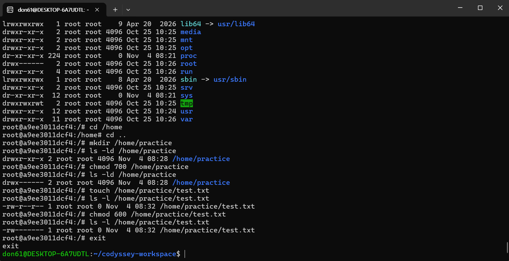
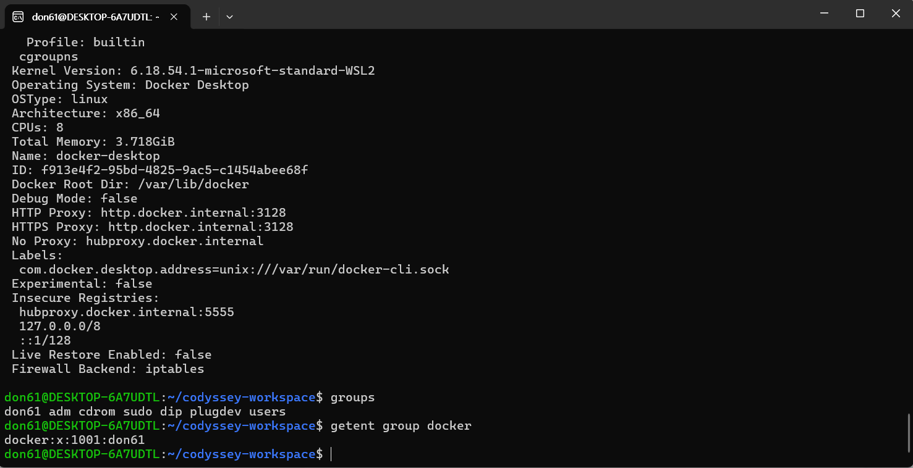
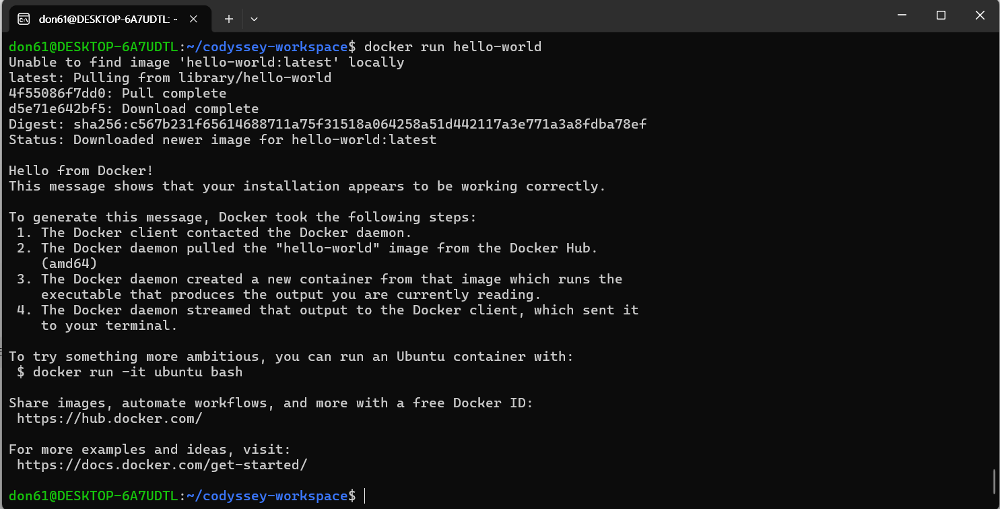
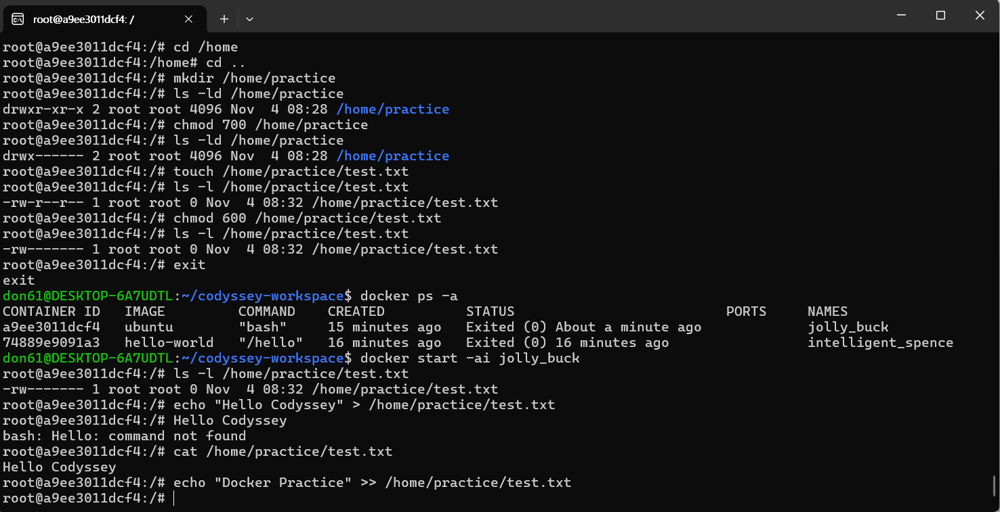
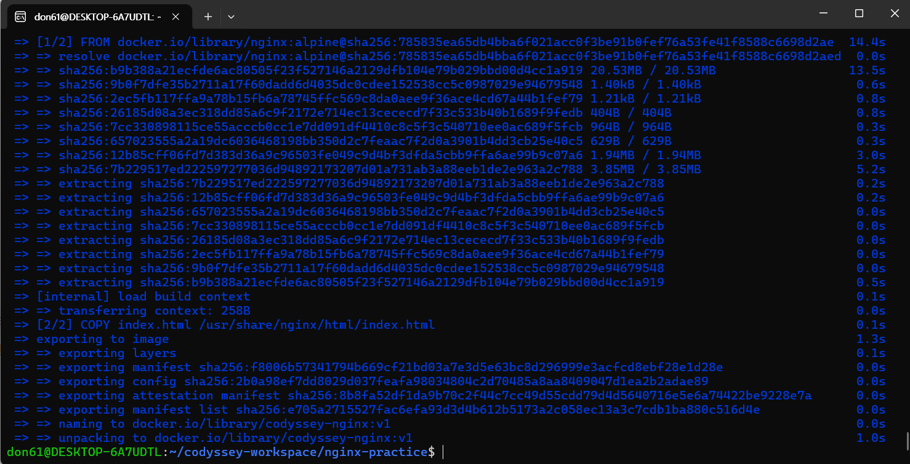
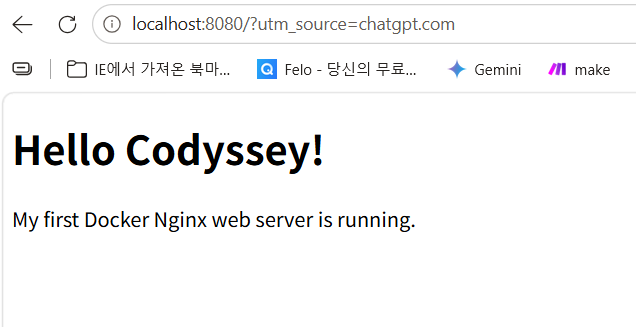
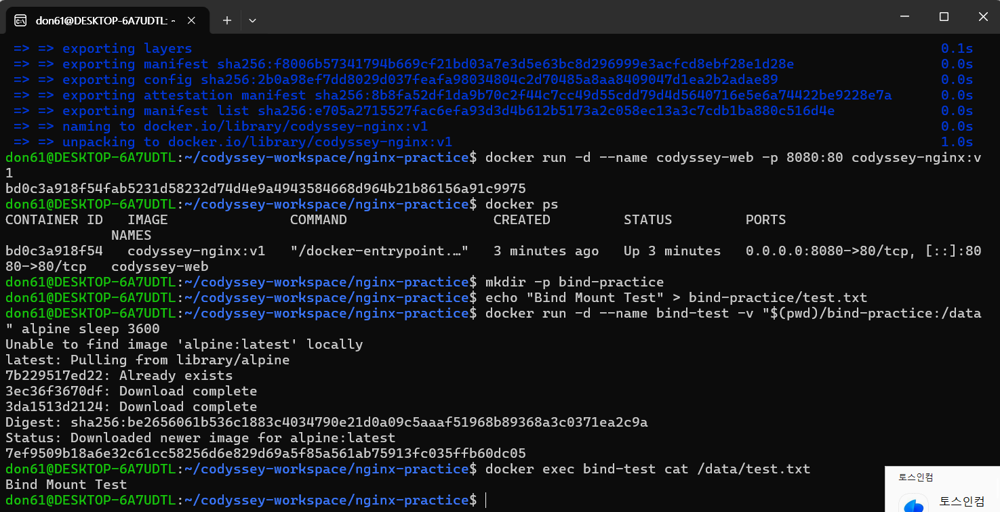
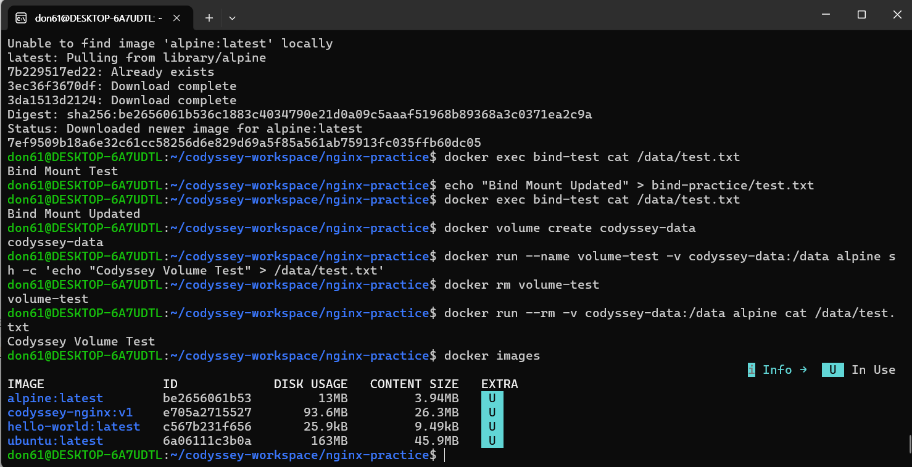
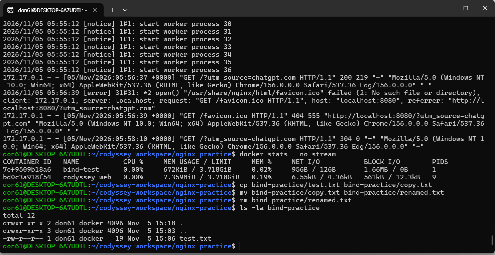
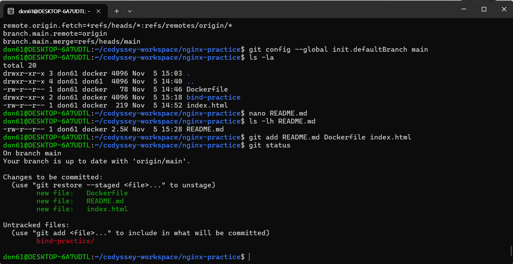
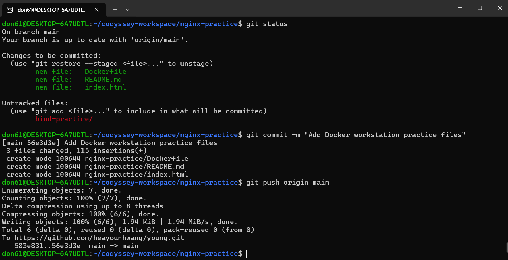
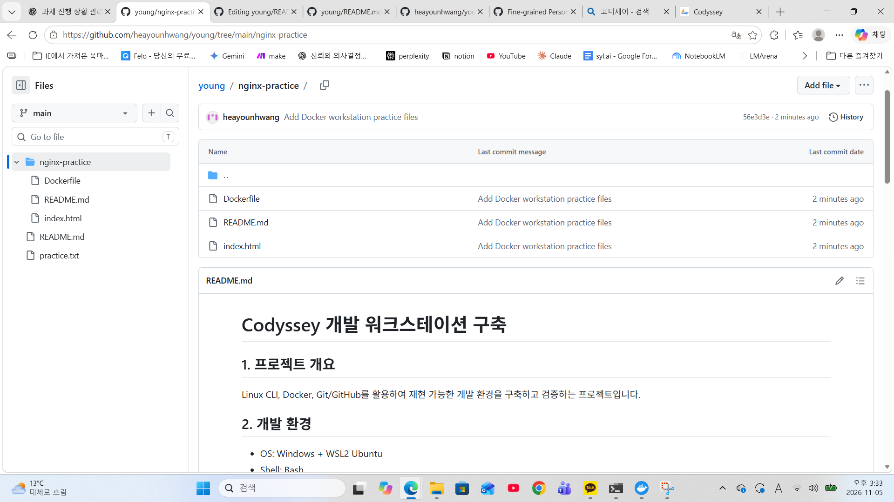
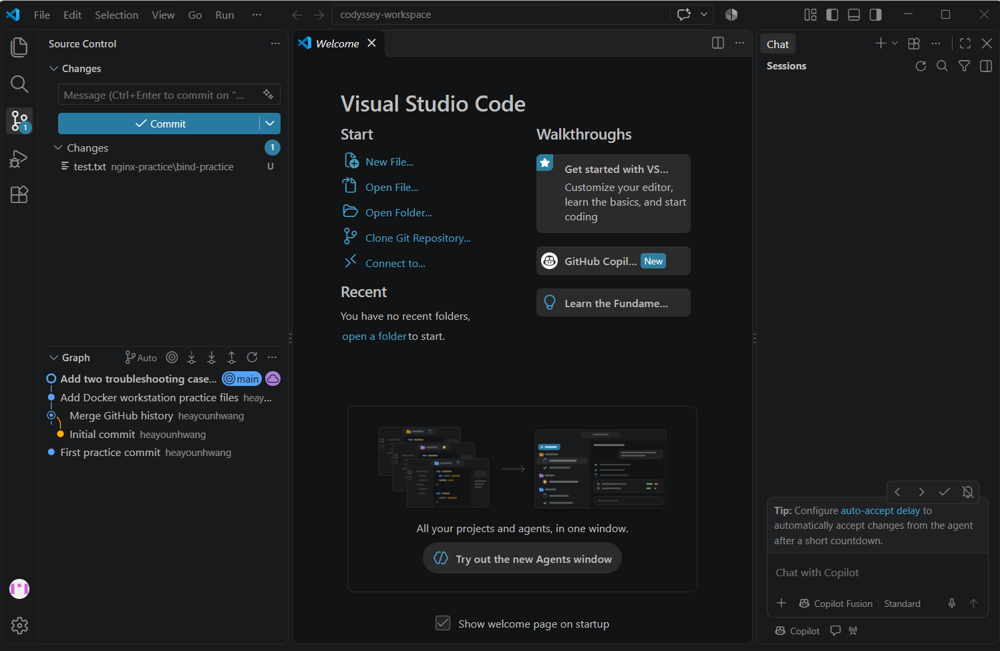


## 10. AI 사전평가 FAIL 항목 보완

### #2. Linux 파일 권한 변경 검증

권한 변경 전후의 실습 증거:


`ls -l`은 파일 권한을 확인하고, `chmod`는 파일 권한을 변경하는 명령어입니다. 변경 전후의 실제 결과는 위 스크린샷에 기록되어 있습니다.

### #10. 프로젝트 디렉터리 구조

```text
codyssey-workspace/
└── nginx-practice/
    ├── README.md
    ├── Dockerfile
    └── evidence/
        ├── 01_permissions_before_after.png
        ├── ...
        └── 13_vscode_source_control.png

        ### #12. Docker 이미지와 컨테이너의 차이

- Docker 이미지(Image): 프로그램과 실행 환경을 담은 설계도입니다.
- Docker 컨테이너(Container): 이미지를 기반으로 생성하고 실행하는 독립적인 환경입니다.
- `docker build`: Dockerfile을 이용해 이미지를 만듭니다.
- `docker run`: 이미지로 컨테이너를 생성하고 실행합니다.
- 실행 중 컨테이너 내부에서 파일을 변경할 수 있지만, 컨테이너를 삭제하면 해당 변경 사항도 사라질 수 있습니다.
- 중요한 데이터는 Docker 볼륨이나 바인드 마운트를 이용해 보존합니다.

### #13. 네트워크 네임스페이스와 포트포워딩

Docker 컨테이너는 일반적으로 호스트와 분리된 네트워크 네임스페이스를 사용합니다.

네트워크 네임스페이스는 IP 주소, 네트워크 인터페이스, 라우팅 정보 등을 격리합니다.

`-p 8080:80`은 호스트의 8080번 포트를 컨테이너의 80번 포트에 연결합니다.

따라서 컨테이너의 NGINX가 80번 포트에서 실행 중이면 브라우저에서 `http://localhost:8080`으로 접속할 수 있습니다.

### #14. 호스트와 컨테이너 경로 선택 기준

- 호스트 경로: 내 컴퓨터(또는 WSL)에 있는 파일 위치
- 컨테이너 경로: Docker 컨테이너 내부의 파일 위치
- 절대 경로: `/home/don61/...`처럼 파일 위치를 명확히 지정하는 경로
- 상대 경로: `./`처럼 현재 작업 폴더를 기준으로 지정하는 경로

바인드 마운트는 호스트 파일을 컨테이너에 연결하는 기능입니다.

재현성을 높이려면 호스트 경로는 절대 경로 또는 `$(pwd)`로 명확히 지정하고, 컨테이너 내부 경로는 절대 경로를 사용하는 것이 좋습니다.

### #15. Linux 파일 권한 rwx와 숫자 표기법

Linux 파일 권한은 소유자, 그룹, 기타 사용자 순서로 표시합니다.

- r (read): 읽기 권한 = 4
- w (write): 쓰기 권한 = 2
- x (execute): 실행 권한 = 1

예시: `chmod 755 파일명`

755의 의미:
- 소유자: 7 = 4+2+1 = rwx
- 그룹: 5 = 4+1 = r-x
- 기타 사용자: 5 = 4+1 = r-x

따라서 755는 `rwxr-xr-x` 권한을 의미합니다.

`ls -l` 명령어로 파일의 현재 권한을 확인할 수 있습니다.

### #16. 포트 충돌 진단 및 해결 절차

포트 충돌은 여러 프로그램이 같은 호스트 포트를 사용하려고 할 때 발생할 수 있습니다.

다음은 포트 충돌 시 사용하는 진단 및 해결 절차입니다.

1. `docker ps` : 실행 중인 컨테이너와 포트 확인
2. `sudo ss -ltnp '( sport = :8080 )'` : 8080 포트를 사용하는 프로세스 확인
3. `sudo lsof -iTCP:8080 -sTCP:LISTEN -n -P` : 포트 사용 프로세스 추가 확인
4. `docker stop 컨테이너이름` : 해당 컨테이너가 불필요한 경우 중지
5. `docker run -d --name codyssey-web-alt -p 8081:80 codyssey-nginx:v1` : 기존 포트를 유지해야 할 경우 8081 포트로 변경
6. `curl -I http://localhost:8081` : HTTP 응답 확인

Windows에서는 `netstat -ano | findstr :8080`으로 포트 사용 프로세스의 PID를 확인할 수 있습니다.

주의: 위 명령어는 포트 충돌 해결 방법을 설명하기 위한 예시이며, 실제 실행 로그는 아닙니다.